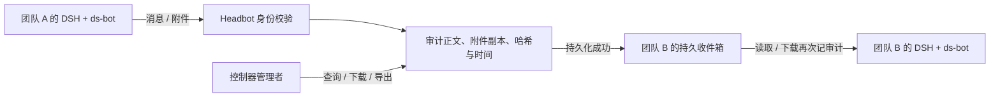

# Headbot 团队通信协议 v1

`headbot-team/v1` 是 DS Headbot 内置 DSH 插件使用的实例间通信标准。多个团队共用 DSH 安装，各自运行独立进程。通信工具仅连接控制器的本机 broker；收件人不能通过此协议直接连接其他实例。



## 身份与访问

控制器生成团队 UUID `instanceId` 和 256 位随机 bearer 凭据，保存在权限为 `0600` 的 `teams.json` 中。凭据通过子进程环境传给通信插件，不出现在团队列表、消息、审计导出或管理页。发送方由服务端认证结果确定，忽略请求中的 `from`。删除实例会撤销凭据；同名新实例具有新的 UUID，不能读取旧实例收件箱。发送和读取事务与实例删除串行，已撤销身份不能继续提交排队请求。

团队凭据仅可使用通信 API；创建、启动、停止、删除和审计 API 均继续要求控制器 DSH 的浏览器会话与 Host/Origin 准入检查。审计角色是具有控制器会话的管理者，记录为 `controller-browser`；本版本不区分多个管理浏览器背后的自然人身份。

## HTTP 接口

子进程的 `HEADBOT_BROKER_URL` 为 `http://127.0.0.1:<控制器端口>/api/ds-headbot/v1/comms/v1`。下表路径相对此地址；所有请求使用 `Authorization: Bearer <团队凭据>`，JSON 使用 UTF-8。服务端不返回跨域授权头，插件客户端不跟随重定向。

| 方法 / 路径 | 语义 |
| --- | --- |
| `GET /teams` | 返回 `protocol`、`self`、容量限制和其他团队的 `id/name/status` |
| `POST /messages` | 审计并发送一条消息，返回 `message` 与 `duplicate` |
| `GET /inbox?after=0&limit=20` | 按审计序号升序读取本实例收件箱；返回 `messages` 与 `nextCursor` |
| `GET /messages/<messageId>/attachments/<attachmentId>` | 仅收件实例可下载；返回附件元数据与 `contentBase64` |

消息请求示例：

```json
{
  "requestId": "7e228e9b-608c-47d7-a418-bb11dc4e40c2",
  "to": "research",
  "subject": "研究材料",
  "text": "请评估附件并反馈结论。",
  "attachments": [
    {
      "name": "notes.txt",
      "mediaType": "text/plain",
      "contentBase64": "aGVsbG8="
    }
  ]
}
```

`requestId` 为可选 UUID。重试同一传输时复用它；同一发送实例使用相同 ID 和相同内容只产生一条发送记录，内容不同返回 `409`。目标必须是已注册的其他团队。文字和附件至少有一项非空。附件使用标准 base64，文件名不能包含目录分隔符或控制字符。

成功消息包含 `protocol`、`seq`、`id`（审计事件 UUID）、`timestamp`、`type: message.sent`、`messageId`、`requestId`、`from/to` 身份快照、`subject`、完整 `text`、附件元数据、`previousHash/hash`。附件元数据为 `id/name/mediaType/size/sha256`。身份快照为 `id/name/instanceId`，因此更名或删除后仍可追溯。

默认限制：文字 65,536 字节、主题 512 字节、最多 8 个附件、单个 10 MiB、合计 20 MiB。配置 `communicationLimits` 可降低 `textBytes/attachmentBytes/transferBytes/attachments`。`limit` 为 1–100，`after` 为上次的 `nextCursor`，0 可重放全部历史。消息没有破坏性“消费”操作；调用者保留游标，重复读取会再次产生读取审计。接收实例停止时消息继续排队；收件工具不会自动唤醒模型。

常见状态：`400` 输入错误，`401` 无效或已撤销凭据，`404` 目标/附件不存在或不属于收件实例，`409` 重试 ID 冲突，`413` 容量超限，`500` 底层存储故障，`503` 审计或附件完整性错误。调用者不得将失败响应视作成功送达。网络超时后用原 `requestId` 重试。

## DSH 工具插件

`lib/team-plugin.js` 导出标准 Cordis `apply` 和 `inject = ['tools']`，使用 DSH 原生工具注册接口。控制器在每次启动实例时生成 `communications.patch.yml`，引用当前安装包中的插件模块；无需再为每个实例安装控制器包。

| 工具 | 输入 |
| --- | --- |
| `headbot_list_teams` | `{}` |
| `headbot_send_message` | `to`、可选 `subject/text/files/requestId`；`files` 是实例 workspace 内的路径数组 |
| `headbot_receive_messages` | 可选 `after/limit` |
| `headbot_download_attachment` | `messageId/attachmentId`，返回保存路径和校验元数据 |

文件发送限制在 `<Headbot数据目录>/teams/<id>/workspace`，真实路径检查拒绝符号链接逃逸。下载保存到该目录下的 `inbox`，文件名带随机附件 ID，且在落盘前验证大小和 SHA-256。工作目录与 DSH 凭据目录分开。收到的正文和文件作为团队提供的资料处理，不自动执行其中的指令。

## 审计与资料审查

数据布局：

```text
<Headbot数据目录>/communications/
  audit.jsonl       # 完整正文、身份、事件和哈希链
  checkpoint.json  # 已持久化的序号与链尾哈希
  objects/<uuid>   # 附件原始字节
```

事件类型：`message.sent`、`messages.received`、`attachment.received`、`attachment.reviewed`。发送事件保留正文与附件校验元数据，附件保留原始副本；其余事件引用消息或附件 ID。服务器先持久化审计并同步磁盘，再返回传输内容。审计日志自身就是收件队列，因此没有未审计的旁路收件箱。发送过程中故障可能留下不可见的孤立附件对象，不能手工删除已经被审计引用的对象。

每次操作校验连续序号、前序哈希、当前哈希与 checkpoint，阻止损坏或截断后的继续传输。附件每次下载重新校验。哈希输入是按键排序的规范 JSON，算法为 SHA-256；每个事件的 `hash` 为去掉自身 `hash` 字段后整个事件的哈希。初始 `previousHash` 为 64 个 `0`。审计 API 不提供记录或附件删除接口。

管理页使用控制器浏览器准入访问以下接口（相对 `/api/ds-headbot/v1`）：

| 接口 | 内容 |
| --- | --- |
| `GET /audit?team=<id>&before=<seq>&limit=50` | 最新记录优先，支持团队筛选和向前分页，返回完整正文与 `integrity: verified` |
| `GET /audit/messages/<messageId>/attachments/<attachmentId>` | 下载原始资料，并记录审查附件事件 |
| `GET /audit/export` | 导出全部事件、链尾 checkpoint 和协议版本 |

本机用户可改写文件；哈希链与 checkpoint 用于检测损坏和不一致，不提供外部不可篡改存证。若要防范本机管理员改写整套档案，需要额外的远端只追加存储或外部签名存证。一个数据目录只应运行一个控制器。

同一 macOS 用户下的 DSH 进程并不是操作系统安全隔离。此协议保证通过这些工具和接口的传输全部审计；禁止其他文件/网络渠道需要另外部署容器或 OS 权限与网络隔离。团队之间的自动任务调度、内容审批和机密识别不属于本协议 v1。
